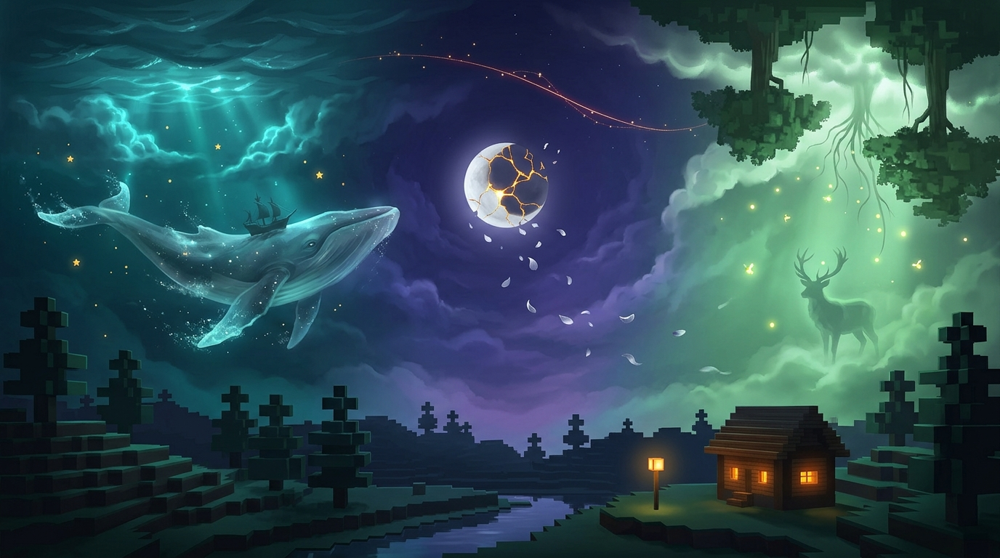

# Veilborne — Six Supernatural Weathers for Minecraft

> *First a single drop falls upward into the night. Then the sky itself remembers something older than clouds.*

**Veilborne (`天幕异闻`)** adds **six regional, multiplayer-synchronized supernatural weathers** to the Minecraft Overworld. Each phenomenon unfolds across six distinct phases over 12–14 minutes—complete with custom core-shader skies, procedural 3D entities, bespoke soundscapes, interactive visitors, craftable relics, an illustrated **Field Journal**, a **1–3 Star Completeness** rating system, and **lasting survival utilities** left behind in your world.

- **Platform:** Minecraft `1.21.1` · NeoForge `21.1.248+` · Java `21`
- **Standalone:** Zero external dependencies (no Veil, Lodestone, or Photon required)
- **Languages:** Full **English** and **Simplified Chinese (`简体中文`)** localization
- **Multiplayer & Base-Safe:** Synchronized across clients; **never breaks buildings, empties chests, or forces you away**

---

## The Six Supernatural Weathers

Only one veil weather occurs at a time, sharing a natural quiet period of **3–6 in-game days** between events (configurable). You can also craft summoning relics or use `/veilborne` commands to experience any weather on demand.

### 1. The Inverted Sea (`星海倒灌`)
> *"First a single drop falls upward into the night. Then the sea opens overhead."*

Water droplets leave rivers and rise into the dark as an immense translucent turquoise ocean unfolds across the heavens.
- **Spectacle:** Rolling sea-clouds, luminous caustics, pouring light falls, and a colossal **Celestial Whale** carrying an ancient shipwreck glides overhead.
- **Encounters:** Open **Astral Drift Bottles** washed ashore; rise gently inside telegraphed **Floating Tide** vortices; board the **Shoreless Skiff** with an old star-fishing boatman—hold forward to sail across the sky-sea to the nearest Shipwreck, Ocean Ruin, Ocean Monument, or Ancient City, and return via a **Homeward Shell**.
- **Lasting Legacy:** Where the whale's five fading scales land, a **Star-Tide Pool** lingers for 3 days, granting bonus celestial fishing loot and **Treasure-Chart Drift Bottles**.

### 2. Moon-Husk Bloom (`月骸花潮`) *(Nighttime Natural Trigger)*
> *"The moon's shell cracks into thin porcelain, and what falls into the night becomes flowers."*

Golden amber light seeps through fractures in a porcelain moon as flakes descend into drifting silver petals and blooming ground flowers.
- **Spectacle:** Procedural Voronoi cracking moon, shedding ceramic shell, delayed purple moon-shadows, and **Three Moons** hanging in a violet sky.
- **Encounters:** Walk alongside the faceless, veiled **Moon Bearers** to reveal their flower road; gather **Moon Dew** from a **Fallen Little Moon** in the grove and witness a viewpoint-only constellation; use the **Silver-Needle Moon Dial** to tell the true moon from its reflections.
- **Lasting Legacy:** **Silver Flower Lanterns** block natural monster spawns within 24 blocks; brew Moon Dew into **Potions of Moonveil** to dramatically shrink mob detection range.

### 3. Mirror-Sky Pilgrimage (`镜天巡礼`)
> *"The sky became a not quite even mirror. The land hangs in it upside down, with one more door than the ground has."*

Silver frost creeps down from the zenith as the sky turns into a vast, uneven Voronoi mirror reflecting the **real chunks and builds around you** upside down—plus one extra tower and one extra door.
- **Spectacle:** Live inverted terrain reflection, spinning warm-tinted sky shards, a hundred-block **Colossal Pilgrim** striding across the mirrored land, and lightning-slow fractures that shatter into falling light.
- **Encounters:** Reveal the extra door with an **Observation Prism** to enter the **Mirror Gallery**, where your delayed reflection fetches the **Echo Mirror**; solve the **Three Misaligned Mirrors**; follow the **Late Traveller**; optionally confront **Glass Beasts** on cracked shards.
- **Lasting Legacy:** Aim the Observation Prism at the **Mirror Tower's foundation** to unearth a buried treasure stone vault; defeat both waves of Glass Beasts *(Optional Risk)* for the **Heart of the Cracked Mirror**, revealing buried chests, spawners, and suspicious blocks through walls for 30 seconds.

### 4. Scarlet Seam (`绯线缝世`)
> *"The robe of heaven has no seams. It is only that, every so many years, someone comes to mend it."*

The sky turns to draped crimson silk and tears open to a starless dark. A **golden needle longer than a mountain** emerges to suture the burning wound stitch by stitch—then plunges into the earth to sew the land to the sky.
- **Spectacle:** Fire-rimmed tear anchored above the land, physical 3D stitching needle, sweeping shadow of an unseen hand pulling the thread taut, film-like moment overlays, and a seam cooling into a band of stars.
- **Encounters:** Read telegraphed **Needle Strike** rings; race the brass six-legged **Needle Walker** for its three loose ends; calm the **Unsewn Pocket** with a **Tuning Anchor** while fending off Thread Spirits; choose to **Hold the Line** or **Cut the Land Stitch** with shears before the pull.
- **Lasting Legacy:** Leaving the stitch intact grants a linked pair of **Sky-Weaving Lamps**—interact with an empty hand to zip along the scarlet thread between them, and sew your own long-distance warp network with Scarlet Thread. Catch a **Needle Core** at the dead centre of a strike ring *(Optional Risk, requires Binding Knot)* to sew **cross-dimensional** links using just a single thread.

### 5. Silent Daylight (`无声白昼`)
> *"When the world had gone quite silent, there came a single soft knock at the door."*

Sound retreats layer by layer—music, wind, animals, blocks, even your own footsteps—as a tide of pale grey washes across an overexposed, frozen noon. Only lanterns preserve a warm sepia glow.
- **Spectacle:** A lightless **Black Sun** rises in the north, bending the sky via gravitational lensing and drinking ribbons of colour until totality flashes an Einstein ring and dark corona; later, a razor-white line stands on the horizon, followed 34 seconds later by thunder and the first bird singing colour back.
- **Encounters:** In the silence, **raising a light** (right-click air with a torch or lantern) is your voice—answer the **Empty Coat** knocking three times at your door, greet the **Silent Procession**, and follow **The Only Bell** to its colourful Island of Sound.
- **Lasting Legacy:** Hold the **Silent Lantern** so Sculk Sensors, Shriekers, and Wardens cannot hear your actions; place **Still Candles** to swallow all vibrations within 6 blocks (perfect for Ancient Cities). Deliberately make noise in the silence *(Optional Risk)* to summon an enraged Warden and survive until the bird sings for Echo Shards.

### 6. Verdant Dream (`苍翠梦潮`)
> *"A forest grew upside down out of the clouds. A deer carrying a whole wood in its antlers walked by along its roots."*

Clouds soften to emerald down as an inverted forest grows downward across the sky, trailing gnarled aerial roots to the hilltops while schools of leaf-fish swim overhead.
- **Spectacle:** Layered backlit upside-down canopy, bioluminescent night veins and fireflies, dappled leaf-light, a glowing **Dream Tree** with a petal path, and a translucent **Forest-Bearing Giant Deer** walking a road of roots before the entire canopy turns honey-gold and sheds its leaves.
- **Encounters:** Stand quietly beneath the Dream Tree to earn the Giant Deer's downward glance and gift; guide **Lost Leaf-Fish** out of cottage windows into the open sky; complete the **Vine Enclosure** light-chase; guide hovering **Dream Seeds** down to open soil (or into a deer hoofprint).
- **Lasting Legacy:** Planted Dream Seeds grow decorative trees anchored by a **Dream Tree Heart**—accelerating nearby crops, baby animal growth, and breeding cooldowns (~2× speed) with frequent twin births. **Dream Leaves** feed and breed *every* animal type and compost reliably.

---

## Lasting Survival Utilities & Completeness Grades

Every weather leaves behind meaningful survival progression—and grades your participation from **★☆☆ to ★★★** with bonus keepsakes (3 stars is always achievable **without** taking optional risks):

| Weather | Vanilla Need | Lasting Utility | Optional Risk Challenge |
| --- | --- | --- | --- |
| **The Inverted Sea** | Exploration | Skiff Voyages to structures + Homeward Shell; 3-day Star-Tide Fishing Pool & Treasure Charts | — |
| **Moon-Husk Bloom** | Night Safety | Silver Flower Lantern (24-block mob-spawn ward); Potion of Moonveil (stealth) | — |
| **Mirror-Sky Pilgrimage** | Treasure Hunting | Buried Mirror Tower Vault with loot & enchanted books | 2 waves of Glass Beasts → **Heart of the Cracked Mirror** (32-block X-ray for chests & spawners) |
| **Scarlet Seam** | Fast Travel | Linked Sky-Weaving Lamp teleport network sewn with Scarlet Thread | Stand at strike center w/ Binding Knot → **Needle Core** (1-thread cross-dimensional links) |
| **Silent Daylight** | Deep Dark / Stealth | Silent Lantern (personal sculk silence) & Still Candle (6-block vibration dampener) | Ring a bell / play music in the silence → Survive enraged Warden → Echo Shards |
| **Verdant Dream** | Farming & Ranching | Dream Tree Heart (~2× crop & breeding boost + twins); Dream Leaves (universal animal feed) | — |

---

## Field Journal & Getting Started

- **Automatic Guidebook:** The first time you witness any veil weather, you automatically receive the **Field Journal of the Veil** (or craft it anytime with **1 Amethyst Shard above 1 Book**).
- **Six Illustrated Chapters:** Flip spreads with arrows, scroll wheel, or arrow keys; press `Tab` to switch weather chapters. Each chapter records phases, visitors, recipes, **Your Marks** (saved coordinates of active pools, voyages, tower vaults, and lamp pairs), and **Completeness** checklists.
- **On-Demand Summoning Relics:** Every weather has a craftable summoning item usable under open Overworld sky when no other veil weather is active (*Tide Attuner*, *Moonward Bell*, *Light-Through Mirror*, *Needle of the Heavenly Robe*, *Stopped Clock*, *Deer-Call Flute*).

---

## Commands & Configuration

Operator / cheat commands (Overworld only):

```text
/veilborne starfall    start [seconds] | stage <0-99> | status | stop
/veilborne moonbloom   start [seconds] | stage <0-99> | status | stop
/veilborne mirrorsky   start [seconds] | stage <0-99> | status | stop
/veilborne scarletseam start [seconds] | stage <0-99> | status | stop
/veilborne silentday   start [seconds] | stage <0-99> | status | stop
/veilborne dreamtide   start [seconds] | stage <0-99> | status | stop
```

- **Client Config (`config/veilborne-client.toml`):** Quality presets (`0` Light / `1` Balanced / `2` Cinematic), soundscape volume, effect brightness, plus individual toggles for moon-shadow lag, live mirror reflections, afterimages, scarlet moment overlays, world silence/desaturation, leaf-fish, and ground patterns.
- **Server Config (`saves/<world>/serverconfig/veilborne-server.toml`):** Toggle natural spawning per weather, adjust quiet-day intervals (`3–6` days default), event durations (`120–3600s`), region radius, and individual encounters (Mirror Gallery, Needle Strikes, visitors, etc.).

---

## FAQ & Compatibility

- **Is this mod safe for my survival base?**
  Yes! None of the six weathers destroy player builds, alter containers, or trap you. Even the Mirror Gallery always returns you safely to the door if you exit, fall, log out, or if the weather ends.
- **Does it work on multiplayer servers?**
  Yes. Install Veilborne on both the server and all clients. Sky states, entities, encounters, and world marks are synchronized cleanly.
- **Does it require any library mods?**
  No—Veilborne is completely standalone and uses vanilla Minecraft core shaders for maximum lightness and stability.
- **Shader / performance tips?**
  Because Veilborne relies on custom core shaders and full-screen sky/post passes for its six supernatural skies, vanilla rendering (or disabling conflicting sky overrides in shader packs) delivers the most faithful visual experience. You can adjust `quality` (`0`/`1`/`2`) or disable live chunk reflections (`mirrorReflections = false`) in `veilborne-client.toml` on lower-end GPUs.

---

*Author: **suiyi** · License: **MIT***
