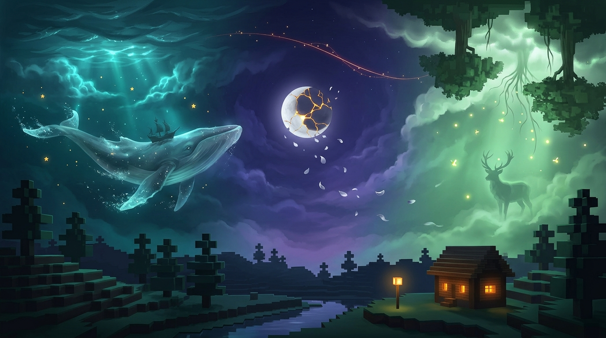

# 天幕异闻 · Veilborne — 六种奇幻超自然天幕异象

> *夜空先漏下一滴向上流的水。随后，头顶的苍穹记起了比云层更古老的事。*

**《天幕异闻 · Veilborne》** 为 Minecraft 主世界带来 **六种区域性、多人同步的超自然奇幻天气**。每一场异象都会在 12–14 分钟内历经六个层次分明的阶段——融合自定义核心着色器天穹、程序化三维巨物与来客、定制原创声景、交互式奇遇、六章插画**《天幕观测手记》**、**一至三星完整度结算**，以及真正融入原版生存体验的**长期余泽**。

- **支持平台：** Minecraft `1.21.1` · NeoForge `21.1.248+` · Java `21`
- **独立运行：** 零前置依赖（无需安装 Veil、Lodestone、Photon 等渲染库）
- **内置语言：** 完整**简体中文**与 **English** 双语本地化
- **联机与存档安全：** 多人状态完整同步；**绝不破坏玩家建筑、不清空容器、不强行掳走玩家**

---

## 六大天幕异象一览

六种异象同一时间仅发生一种，并共享 **3–6 个游戏日** 的自然平静期（可配置）。你也可以合成各异象专属的唤潮道具，或使用管理员命令随时预览。

### 1. 星海倒灌（The Inverted Sea）
> *「夜空先漏下一滴向上流的水。随后，海在头顶张开。」*

水滴离开河面逆流升空，整片深邃透亮的青绿星海在头顶翻涌铺展。
- **天幕奇观：** 翻卷的海云焦散、垂落大地的光瀑，以及背负古老沉船、拍动尾鳍越过天穹的**古鲸**。
- **交互奇遇：** 拾取随星潮抵岸的**漂流瓶**；步入金色预告转青的**浮潮涡**凌空缓落；登上悬空垂钓星辰的**无海之舟**——按住前进键，蓑笠翁便载你顺星海远航至该方向最近的沉船、海底废墟、海底神殿或远古城市，并赠予一枚**归岸贝**送你回家。
- **长期余泽：** 鲸鳞落点将留下持续三天的**星潮池**，40 格内垂钓可额外收获星海渔获与**卷着藏宝图的漂流瓶**。

### 2. 月骸花潮（Moon-Husk Bloom）*（仅入夜后自然触发）*
> *「月亮的外壳裂成薄瓷，落进夜里，便成了花。」*

瓷质明月裂开一道道透出琥珀金光的细纹，剥落的月瓷化作银白花瓣飘散夜空，在草坡与小路上绽放成片花影。
- **天幕奇观：** 程序化 Voronoi 裂壳瓷月、动作慢半拍的紫色月影，以及高潮阶段悬于紫夜的**三月同天**。
- **交互奇遇：** 保持距离与无面披纱的**送月人**同行以显出隐藏花路；林间偶遇**落地的小月亮**，以空瓶接取**月露**并站在金环中仰望只在该角度成立的星座；用**银针月仪**借落瓣风向与月影方向辨出真月。
- **长期余泽：** **银花灯**周围 24 格内阻断怪物自然生成（月下安地）；月露可酿造**月隐药水**，大幅缩短怪物侦测距离。

### 3. 镜天巡礼（Mirror-Sky Pilgrimage）
> *「天空成了一面不太平整的镜子。镜里的大地倒悬着，只比地上多了一扇门。」*

银霜自天顶漫下，整片天空化作不平整的巨大镜面，**实时倒映你周围真实的方块与建筑**——只是镜里多了一座塔、一扇门。
- **天幕奇观：** 真实区块倒悬反射、昼银夜青的碎镜接缝、百格高的青金长袍**巡礼者**踏波而来并驻足俯望，最终整片镜天如极慢闪电般龟裂坠落。
- **交互奇遇：** 以**观测棱镜**对准现实墙面揭开**多出来的门**，踏入无伤独立空间**镜廊**，让慢一拍的镜中自己替你取来**回响镜**；辨认三面**错位路标**中照着此刻的那一面；跟随**迟到的旅人**；可选择唤醒低处裂片上的**镜兽**。
- **长期余泽：** 举起观测棱镜对准**镜中之塔的地基**，即可在现实地下挖出藏有附魔书与珍宝的旧石室；【可选险路】打完两波镜兽获赠**裂镜之心**，捏碎后 32 格内所有箱子、刷怪笼、可疑方块透墙显形 30 秒。

### 4. 绯线缝世（Scarlet Seam）
> *「天衣本无缝。只是每隔许多年，就有人来补一次。」*

苍穹化作垂挂的绯红丝绸，从中央撕开一道燃着金红火焰、内里毫无星光的伤口。一根比山更长的**金针**自裂缝彼端穿出，一针一针缝合苍穹，随后扎入大地将世界缝向天幕。
- **天幕奇观：** 锚定于大地上空的燃火天裂、真实穿刺针眼的巨型金针、天幕背后掠过的**巨手皮影**、胶片残影叠层，以及冷却化作银河星带的金线。
- **交互奇遇：** 识别地上宽阔的**落针预告符环**；与六足黄铜**走针者**竞速抢接散落线头；在**未缝合的口袋**中放下**调律锚**收拢时缝残丝并应对线灵；拉线前可选择站在线上**护线**，或持剪刀**剪断**缝地之线。
- **长期余泽：** 护线完成后，两处落针点留下一对相连的**织天灯**，空手右键即可顺绯线快速传送，并可用绯线自行缝制全图传送网；【可选险路】携带系缚结立于落针圈正中接下**针芯**，此后仅需 1 根绯线即可**跨维度**缝连主世界、下界与末地。

### 5. 无声白昼（Silent Daylight）
> *「世界彻底安静以后，门外传来了唯一的一次轻敲。」*

音乐、风声、洞穴、动物、方块乃至脚步声逐层退去；灰色如潮水般漫过大地，世界漂白成一片静止、过曝的苍白正午，唯独灯火旁残留旧照片般的暖黄。
- **天幕奇观：** 一颗不发光的**黑日**自北方升起，以引力透镜弯曲天空、将世界色彩抽成十四道细带吞噬；全蚀时闪现爱因斯坦环与漆黑日冕；随后地平线立起笔直白线，34 秒后迟雷响起，第一只鸟的鸣叫唤回万物色彩。
- **交互奇遇：** 寂静之中，**手持火把或灯笼对空右键「举灯」即是你的声音**——回应门外轻敲三下的**敲门的空位**，向路过的**无声行列**致意，循着波纹寻访**唯一还在响的铃**并步入恢复声色的有声岛。
- **长期余泽：** 手持**无声提灯**时，幽匿感测体、尖啸体与监守者完全听不见你的动静；放置**静烛**可吞噬周围 6 格内一切振动（深暗之域探险神器）；【可选险路】在寂静中故意敲钟奏乐引来被激怒的监守者，撑到第一只鸟鸣叫即可获赠回响碎片。

### 6. 苍翠梦潮（Verdant Dream）
> *「云里长出了一片倒悬的森林。有一头鹿，托着整片林子，从树根上走了过去。」*

云朵变得如绒毛般柔和泛绿，整片森林从云中倒悬向下生长，缠绕的气根一路垂向山巅，成群叶鱼在半空游曳俯冲化作满地花纹。
- **天幕奇观：** 逆光翡翠树冠与夜间荧光叶脉、流动叶影、沿花瓣之路通往的发光**梦树**，以及通体近乎光雾透明、鹿角间长着整片小树林与小屋的**托林巨鹿**；尾声林海逐棵转作蜜金落叶，回归寻常云朵。
- **交互奇遇：** 在梦树下静立等候巨鹿停步低头回眸并获赠梦种；持花或花灯将困于窗边的**失路叶鱼**引回天空；挑战随时可退出的**梦藤围场**追光游戏；蹲下或持花引导降落的**梦种**扎根泥土（若落入巨鹿蹄印，还将有意外收获）。
- **长期余泽：** 梦种种出的梦树底部自带**梦树心**，令周围 8–12 格内作物生长、幼崽成长与繁殖冷却约翻倍，并常生双胞胎；**梦树叶**可喂养并繁殖*所有*原版动物，亦极易堆肥。

---

## 余泽体系与完整度结算

六种异象各自对应一项原版生存核心痛点，并在每场结束时按你的参与情况结算 **★☆☆ 至 ★★★ 完整度** 与额外余赠（**不走险路、不依赖隐藏项亦可稳定拿到三星**）：

| 天幕异象 | 对应生存需求 | 留下的长期实用之物 | 可选险路挑战 |
| --- | --- | --- | --- |
| **星海倒灌** | 探索与寻路 | 无海之舟远航 + 归岸贝；三天星潮池（额外星海渔获与藏宝图漂流瓶） | — |
| **月骸花潮** | 夜晚与防怪 | 银花灯（24 格阻断刷怪）；月隐药水（隐蔽潜行） | — |
| **镜天巡礼** | 地下寻宝 | 镜中之塔地下旧石室宝箱（必出高等级附魔书） | 打完两波镜兽 → **裂镜之心**（32 格透视箱子与刷怪笼） |
| **绯线缝世** | 远距离交通 | 相连织天灯传送网（可用绯线自行搭建） | 落针圈正中接针 → **针芯**（仅耗 1 线跨维度缝灯） |
| **无声白昼** | 古城与潜行 | 无声提灯（个人全程静音）与静烛（6 格吞噬振动） | 寂静里故意出声 → 撑过监守者至鸟鸣 → 回响碎片 |
| **苍翠梦潮** | 农业与牧场 | 梦树心（约 2 倍催熟作物/动物 + 双胞胎）；梦树叶（全动物通用饲料） | — |

---

## 天幕观测手记与入门指南

- **自动赠书：** 首次进入任一天幕异象区域时自动获赠**《天幕观测手记》**（也可在工作台以 **1 紫水晶碎片置于 1 书本上方** 合成）。
- **六章五跨页：** 支持鼠标滚轮、方向键翻页，`Tab` 切换章节；完整收录六阶段纪要、奇遇线索、工艺配方、**你的标记**（自动记录星潮池、远航点、塔基宝箱与织天灯坐标）以及**完整度**实时追踪。
- **主动唤潮道具：** 六种异象均提供可在主世界露天使用的合成召唤物（*听潮信标、望月铃、透光镜、天衣针、停摆钟、鹿鸣笛*）。

---

## 命令与配置

管理员 / 作弊预览命令（仅限主世界）：

```text
/veilborne starfall    start [秒数] | stage <0-99> | status | stop
/veilborne moonbloom   start [秒数] | stage <0-99> | status | stop
/veilborne mirrorsky   start [秒数] | stage <0-99> | status | stop
/veilborne scarletseam start [秒数] | stage <0-99> | status | stop
/veilborne silentday   start [秒数] | stage <0-99> | status | stop
/veilborne dreamtide   start [秒数] | stage <0-99> | status | stop
```

- **客户端配置（`config/veilborne-client.toml`）：** 支持画质档位（`0` 轻量 / `1` 均衡 / `2` 电影）、声景音量、特效亮度，以及月影延迟、真实镜面倒影、残影、胶片叠层、失声与褪色、叶鱼、地面花纹等每一项感官特效的独立开关。
- **世界配置（`saves/<存档名>/serverconfig/veilborne-server.toml`）：** 可独立开关六种异象的自然触发，自定义平静期天数（默认 `3–6` 天）、持续时长（`120–3600` 秒）、区域半径以及镜廊、落针区与各类来客遭遇。

---

## 常见问题与兼容说明

- **会破坏我的房子或生存基地吗？**
  完全不会。所有异象均遵守无破坏守则，绝不改动玩家建筑或容器；镜廊拥有完善的安全退回机制，离开、超时、坠落、重登或天气结束都会稳妥返回门口。
- **支持多人服务器联机吗？**
  完整支持。服务端与客户端均安装相同版本即可同步所有天幕演出、来客遭遇与余泽标记。
- **性能与光影兼容建议：**
  本模组采用原版核心着色器直接实现全部六种天幕渲染，无需重型渲染库。若搭配第三方光影包，部分改写天空管线的光影可能会遮挡异象天穹；建议以原版渲染体验最佳效果。低配显卡可在 `veilborne-client.toml` 中将 `quality` 调至 `0` 或关闭 `mirrorReflections`（镜天实时区块反射）。

---

*作者：**suiyi** · 开源协议：**MIT License***
